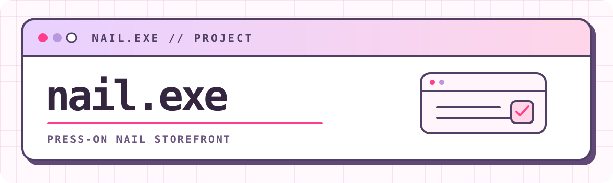

<div align="center">



### A playful press-on nail storefront with a secure, owner-operated catalogue


<br />
<br />

[](https://github.com/mohoamerakram-tech/nail-exe/actions/workflows/ci.yml)
[](https://github.com/mohoamerakram-tech/nail-exe/actions/workflows/codeql.yml)
[](https://nextjs.org/)
[](https://react.dev/)
[](https://www.typescriptlang.org/)
[](https://tailwindcss.com/)

[Storefront](#storefront) · [Admin workspace](#admin-workspace) · [Architecture](#architecture) · [Security](#security-trajectory) · [Contributing](CONTRIBUTING.md)

</div>

> [!IMPORTANT]
> **Pre-release software.** The catalogue and administrator tools are functional, but orders and card payments are not yet connected to production services. Do not accept real orders until the launch requirements in the [security roadmap](docs/security-roadmap.md) are complete.

## Product overview

`nail.exe` combines a character-driven storefront with a private management workspace for a single shop owner. Products, stock levels, publishing state, and homepage campaigns share one catalogue, so an administrator can update the customer experience without editing source code.

<table>
  <tr>
    <td width="50%" align="center">
      
      <br /><strong>Collection browsing</strong>
    </td>
    <td width="50%" align="center">
      
      <br /><strong>Product-led visual identity</strong>
    </td>
  </tr>
</table>

### Current capabilities

| Area | What is available |
| --- | --- |
| Storefront | Homepage campaigns, featured sets, animated characters, vibe-based browsing, search, and product details |
| Shopping | Size selection, stock-aware cart, browser-persisted wishlist, and checkout validation |
| Catalogue | Product creation, editing, drafts, publishing, images, metadata, per-size inventory, and deletion |
| Campaigns | Homepage promotion creation, scheduling metadata, publishing, editing, and removal |
| Administration | Private single-owner login, protected mutations, signed sessions, and an inventory overview |
| Engineering | Type checking, linting, production builds, dependency auditing, CodeQL, and Dependabot |

## Storefront

The customer routes read the same managed catalogue used by the administrator. A size with no remaining quantity is disabled, and a product with no stock across every size is presented as sold out.

| Route | Customer experience |
| --- | --- |
| `/` | Campaign carousel, featured products, brand content, and integrated character animations |
| `/shop` | Full catalogue with optional `vibe` and `q` filters |
| `/shop/[slug]` | Product gallery, description, size selection, availability, and purchase actions |
| `/wishlist` | Products saved in the current browser |
| `/checkout` | Stock-aware checkout interface; payment integration is still pending |

The cart and wishlist providers persist their state in `localStorage`. They are browser-specific and are not customer accounts.

## Admin workspace

| Route | Administrator capability |
| --- | --- |
| `/admin/login` | Authenticate the configured shop owner |
| `/admin` | Review catalogue, inventory, sold-out products, and campaigns |
| `/admin/products` | Search and manage all nail sets |
| `/admin/products/new` | Create a product with pricing, media, details, SEO, and size quantities |
| `/admin/products/[id]/edit` | Edit, publish, restock, draft, or remove a product |
| `/admin/promotions` | Manage homepage campaigns |
| `/admin/promotions/new` | Create a campaign |
| `/admin/promotions/[id]/edit` | Edit, publish, or remove a campaign |

The admin workspace is intentionally designed for one owner. Customer accounts and multi-tenant administrator roles are outside the current scope.

## Architecture

```text
Customer routes                         Administrator routes
app/, app/shop/, app/checkout/          app/admin/
             |                               |
             +----------+  +----------------+
                        |  |
                  lib/catalog/server.ts
                        |
              +---------+---------+
              |                   |
       Local development      Production
       ignored JSON data      Supabase catalogue
```

| Layer | Responsibility |
| --- | --- |
| `app/` | Next.js routes, layouts, loading states, and route-specific UI |
| `app/components/` | Reusable storefront, navigation, cart, and animation components |
| `app/api/admin/` | Authenticated catalogue and campaign mutations |
| `lib/catalog/` | Shared catalogue types, validation boundaries, and persistence access |
| `lib/admin/` | Authentication, session handling, and admin input processing |
| `lib/cart/` | Cart and wishlist browser state |
| `public/images/` | Product photography, brand artwork, and animation frames |
| `supabase/` | Production database schema |

See [architecture.md](docs/architecture.md) for data flows, trust boundaries, and extension guidance.

## Local development

### Requirements

[](https://nodejs.org/)
[](https://www.npmjs.com/)

```powershell
git clone https://github.com/mohoamerakram-tech/nail-exe.git
cd nail-exe
npm ci
Copy-Item .env.example .env.local
npm run dev
```

Open [http://localhost:3000](http://localhost:3000). Use development-only credentials and services. Production catalogue writes fail closed when Supabase is not configured.

### Environment configuration

```env
ADMIN_EMAIL=owner@example.com
ADMIN_PASSWORD_HASH=scrypt\$<salt>\$<hex-digest>
ADMIN_SESSION_SECRET=<at-least-32-random-characters>
ADMIN_CLIENT_IP_HEADER=<trusted-proxy-header-if-required>

SUPABASE_URL=https://<project>.supabase.co
SUPABASE_SERVICE_ROLE_KEY=<server-only-service-role-key>
```

Copy every supported field from [.env.example](.env.example). Never commit `.env.local`, reuse production secrets in development, or expose `SUPABASE_SERVICE_ROLE_KEY` through a `NEXT_PUBLIC_` variable.

### Data behavior

- Local development stores catalogue changes in ignored `data/admin-catalog.json`.
- Local uploads are written to ignored `public/uploads/catalog/`.
- Production uses the schema in [supabase/catalog.sql](supabase/catalog.sql).
- `lib/products.ts` and `lib/promotions.ts` provide seed content until the first administrator save.
- New permanent aesthetics must be added consistently to `NailVibe` and `SHOP_VIBES`.

## Quality checks

```powershell
npm run lint
npm run typecheck
npm run build
npm run audit:prod
```

Run the combined validation before opening a pull request:

```powershell
npm run check
```

Pull requests are validated by GitHub Actions. CodeQL scans JavaScript and TypeScript, Dependabot monitors dependencies and workflow actions, and sensitive areas are assigned through `CODEOWNERS`.

## Security trajectory

Security is treated as a release requirement, not a final cleanup task.

### Implemented baseline

- Signed, `HttpOnly`, `SameSite=Strict` administrator sessions with an eight-hour lifetime
- Authentication and same-origin checks on every catalogue mutation
- Rate-limited login attempts with explicit trusted-proxy configuration
- Request-size and credential-length limits on the login endpoint
- Security response headers, frame blocking, MIME sniffing protection, and restricted browser permissions
- No-cache policy for admin pages and APIs
- Production dependency audit with no known vulnerabilities at the time of the latest repository check
- CI, CodeQL, Dependabot, pull-request review guidance, and private vulnerability reporting documentation

### Required before launch

| Phase | Exit criteria |
| --- | --- |
| Shared staging | Organization MFA, protected `main`, secret scanning, push protection, rotated credentials, durable rate limiting, audit logs, and hardened image processing |
| Orders and payments | Server-owned orders, idempotency, hosted PCI-compliant payments, verified webhooks, retention rules, backups, and integration security tests |
| Public launch | Reviewed threat model, production CSP rollout, automated scans, independent review, incident response procedure, and tested rollback |

Read [security-roadmap.md](docs/security-roadmap.md) for the complete plan and [SECURITY.md](SECURITY.md) for responsible disclosure.

## Repository governance

| Document | Purpose |
| --- | --- |
| [CONTRIBUTING.md](CONTRIBUTING.md) | Development workflow, review expectations, and required checks |
| [SECURITY.md](SECURITY.md) | Supported versions and private vulnerability reporting |
| [docs/architecture.md](docs/architecture.md) | System boundaries and extension points |
| [docs/security-roadmap.md](docs/security-roadmap.md) | Staged path from development to secure launch |
| [docs/github-settings.md](docs/github-settings.md) | Organization access, branch protection, and repository security settings |

## Known limitations

- Checkout does not yet create a server-side order or process card payments.
- Opening a prefilled WhatsApp message is not proof that an order was submitted.
- The mailing-list interface is not connected to a subscription service.
- Wishlist and cart state are local to one browser.
- The current authentication model supports one shop owner, not a staff permission hierarchy.

These are tracked as product and security milestones and must not be represented as production-ready features.

## License and use

This repository is private and currently intended for project collaborators and authorized organization members. Product photography, brand artwork, and character assets are not automatically licensed for reuse outside this project.
